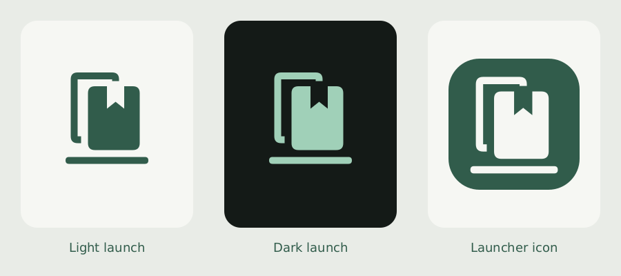
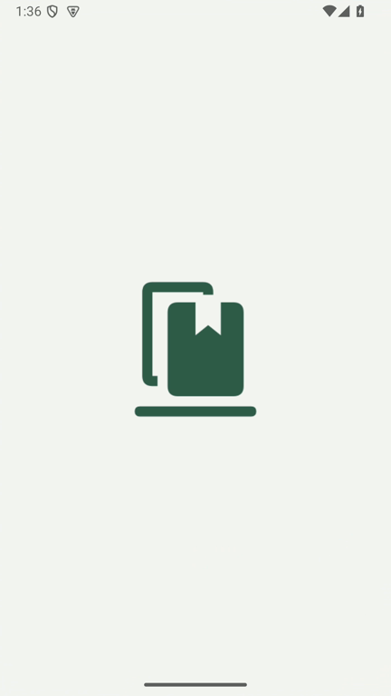
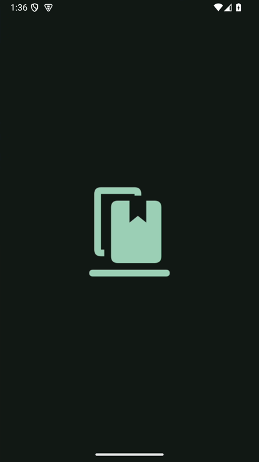

# LinkShelf 0.2.2 branding delivery

The user approved LinkShelf, the cards/bookmark/shelf mark, and a quiet native
launch screen. Version 0.2.2 (code 4) implements the display-name change,
original vector launcher assets (legacy, adaptive and monochrome), and AndroidX
SplashScreen. Light and dark launch colors match the app palette. The saved
appearance is applied to native launch resources. ShareActivity has a transparent
theme and continues to finish immediately after its database save.

The package ID, database name, JSON backup format and scheduled backup filename
rules are unchanged. New manual exports are named LinkShelf. Historical repository
paths and source-code URLs remain valid.

## Validation

- Gradle `:app:testDebugUnitTest`: 61 tests, zero failures/errors.
- Final `:app:lintDebug :app:assembleDebug :app:assembleDebugAndroidTest` passed.
- Isolated read-only API 35 emulator: InboxFlowTest and UxFlowTest passed, 14 tests.
  Coverage includes share return/recreation, saving, archive/delete/undo, search,
  settings and appearance changes. No clearing tests ran on the physical phone.
- Recorded cold launches in system light/dark modes and visually inspected the
  transition from the centered logo to the inbox. No artificial delay is added.
- `git diff --check` passed.
- Installed with `adb install -r` on the connected moto g35 5G; installed package
  reports versionName 0.2.2/versionCode 4. Before/after database snapshots included
  WAL; all 30 records retained identical IDs, canonical URLs, capture/archive/
  deletion/open timestamps, with SQLite integrity OK. A private pre-update backup
  is outside the repository at the existing local device-backup location.

Runtime visual validation used Android 15/API 35. Android 6–11 fallback resources
and compatibility code were built/linted but were not visually checked on an older
device. Phone installation and data integrity were verified; visual evidence is
from the isolated emulator.

## Visual evidence

